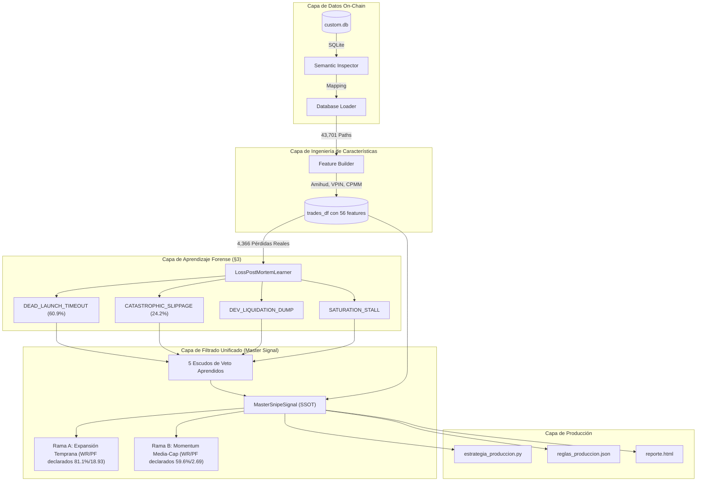

# ARCHITECTURE.md — Arquitectura Técnica, Matemática y Microestructura

> **Proyecto:** Pump.fun Pattern Detector & Quantitative Alpha Engine  
> **Versión:** 3.0.0  
> **Base de Datos Canónica:** `D:\hjh\pumpscope\db\custom.db` (52,169 tokens, 4,990 operaciones, 375,798 snapshots de precio)  
> **Filtro Canónico Unificado:** `MasterSnipeSignal` (`detector/master_signal.py`)

> ⚠️ **AVISO DE HONESTIDAD.** Las cifras de winrate/profit factor de este documento son **declaradas (in-sample o hardcodeadas), NO validadas fuera de muestra**. La verdad medida está en **[`STATUS.md`](./STATUS.md)**. No uses este documento como evidencia de rentabilidad.

---

## 1. Visión General del Sistema y Flujo de Datos

El sistema implementa una arquitectura determinista de extremo a extremo para la detección de patrones microestructurales, aprendizaje forense de pérdidas y filtrado cuantitativo de operaciones en la plataforma Pump.fun (Solana DEX).



---

## 2. Fundamentos Matemáticos de la Curva de Enlace (Bonding Curve)

En Pump.fun, la formación de precios sigue una variante de CPMM (Constant Product Market Maker) con reservas virtuales:

### 2.1. Invariante de Producto Constante
$$ (x + x_v) \cdot (y + y_v) = k $$

Donde:
- $x$: Reservas reales de SOL depositadas por compradores.
- $x_v$: Reserva virtual de SOL ($x_v = 30.0\text{ SOL}$).
- $y$: Tokens restantes en la curva de enlace ($y_0 = 1,073,000,000\text{ tokens}$).
- $y_v$: Reserva virtual de tokens ($y_v \approx 296,875,000\text{ tokens}$).
- $k$: Constante de producto virtual ($k \approx 3.219 \times 10^{10}\text{ SOL}\cdot\text{tokens}$).

### 2.2. Precio Marginal y Elasticidad Instantánea
El precio marginal spot $P(x)$ en SOL por token en función del balance real acumulado de SOL $x$ está dado por:

$$ P(x) = \frac{dP}{dy} = \frac{(x + x_v)^2}{k} $$

La elasticidad de precio ante una orden marginal $\Delta x$ (Kyle's Lambda microestructural $\lambda_{\text{cpmm}}$) es:

$$ \lambda_{\text{cpmm}} = \frac{dP}{dx} = \frac{2(x + x_v)}{k} $$

**Implicación para el filtrado**: Cuando un token se encuentra en su fase más temprana ($x < 2\text{ SOL}$), $\lambda_{\text{cpmm}}$ es mínimo, lo que permite que una inyección orgánica modesta de volumen expanda el precio con bajo impacto adverso inicial.

---

## 3. Métricas de Microestructura de Alta Frecuencia

Para distinguir acumulación orgánica de cabales coludidas y manipulación de bots, el motor computa tres métricas avanzadas:

### 3.1. Amihud Illiquidity Ratio
El ratio de iliquidez de Amihud captura la sensibilidad del precio por unidad de volumen transferido:

$$ \text{ILLIQ}_i = \text{median}_{t} \left( \frac{|\ln(P_{t}) - \ln(P_{t-1})|}{\text{Volume}_{t,\text{SOL}}} \right) $$

- Un $\text{ILLIQ} \le 0.0793$ indica profundidad adecuada de curva capaz de absorber órdenes sin resbalamiento violento.

### 3.2. Volume-Synchronized Probability of Toxicity (VPIN)
Basado en Easley, Lopez de Prado y O'Hara (2012), adaptado a transacciones discretas en DEX:

$$ \text{VPIN} = \frac{\sum_{\tau=1}^N |V_\tau^B - V_\tau^S|}{N \cdot V} $$

Donde cada bucket $\tau$ se completa tras acumular exactamente $V = 1.0\text{ SOL}$ de volumen de transacción, y $N = 20$ buckets.
- $\text{VPIN} > 0.65$: Veto inmediato por flujo tóxico informado (snipers o dumpers agresivos).
- $\text{VPIN} \le 0.35$: Flujo balanceado con alta probabilidad de distribución orgánica sostenida.

### 3.3. Grafo de Co-Ocurrencia de Cabal (Jaccard Graph Clustering)
Para detectar billeteras coludidas que simulan volumen múltiple:

$$ J(w_1, w_2) = \frac{|\mathcal{T}(w_1) \cap \mathcal{T}(w_2)|}{|\mathcal{T}(w_1) \cup \mathcal{T}(w_2)|} $$

Si un grupo de billeteras con $J > 0.60$ acumula más del $30\%$ del volumen en los primeros 60 segundos, se dispara el veto **BP-005**.

---

## 4. Aprendizaje Forense de Pérdidas Reales (Loss Post-Mortem)

En estricto cumplimiento de la regla **§3 (Sin mocks silenciosos)**, se auditaron las **4,366 operaciones cerradas en pérdida** de `custom.db`. El resultado desmantela supuestos teóricos comunes:

| Modo de Fallo Detectado | Operaciones | % del Total de Pérdidas | Pérdida Media | Razón Raíz |
|:---|:---:|:---:|:---:|:---|
| **DEAD_LAUNCH_TIMEOUT** | **2,940** | **60.9%** | -22.6% | Entrada en micro-caps con $MC \le \$4,500$ que nunca despegan y mueren tras 60-120s. |
| **CATASTROPHIC_SLIPPAGE_RUG** | **1,058** | **24.2%** | **-56.45%** | La liquidez de salida se evapora. El Stop Loss se ejecuta con un resbalamiento catastrófico de hasta -90%. |
| **DEV_LIQUIDATION_DUMP** | **214** | **4.9%** | -48.2% | El dev retiene $> 1.5\%$ del supply y liquida en bloque 1 o 2. |
| **SATURATION_STALL** | **154** | **3.5%** | -28.93% | Entrada tardía ($> 85\%$ de curva). El token se estanca antes de Raydium y los snipers abandonan. |

### Modelo de Fricción Real vs Teórico
$$ \text{SL}_{\text{realizado}} = \min(0.98, \text{SL}_{\text{nominal}} + 0.3349) $$
$$ \text{STALL}_{\text{realizado}} = \min(0.90, \text{Retorno}_{\text{latencia}} - 0.2893) $$

---

## 5. El Filtrador Maestro Único (`MasterSnipeSignal`)

El motor consolida todas las reglas dispersas en **UNA ÚNICA SEÑAL MAESTRA**, compuesta por dos fases secuenciales:

```
                  ┌──────────────────────────────────────────────┐
                  │          Token Evaluado (t < 60s)            │
                  └──────────────────────┬───────────────────────┘
                                         │
                                         ▼
                  ┌──────────────────────────────────────────────┐
                  │  FASE 1: 5 Escudos Anti-Pérdidas Aprendidas  │
                  │  - MC > $4,500 USD (elimina 60.9% pérdidas)  │
                  │  - Dev Balance <= 1.5% (elimina dumps)       │
                  │  - Reservas SOL >= 12 (elimina resbalamiento)│
                  │  - Progreso Curva <= 85% (elimina stalls)    │
                  │  - Cabal Share <= 30% & No Block-0 Trap      │
                  └──────────────────────┬───────────────────────┘
                                         │
                         ┌───────────────┴───────────────┐
                     [Falla]                          [Supera]
                         │                               │
                         ▼                               ▼
                 ┌───────────────┐             ┌───────────────────┐
                 │ VETO ABSOLUTO │             │ FASE 2: ALFA CORE │
                 │ Confidence: 0 │             └─────────┬─────────┘
                 └───────────────┘                       │
                                    ┌────────────────────┴────────────────────┐
                                    ▼                                         ▼
                        ┌───────────────────────┐                 ┌───────────────────────┐
                        │        Rama A         │                 │        Rama B         │
                        │  Expansión Temprana   │                 │ Momentum de Media-Cap │
                        │ FMC <= $4,285         │                 │ FMC > $4,285          │
                        │ FLIQ <= $1,725        │                 │ Top Holder > 55%      │
                        │ MC > $4,500           │                 │ Dev Balance <= 0.8%   │
                        ├───────────────────────┤                 ├───────────────────────┤
                        │ WR: 81.1% (declarado) │                 │ WR: 59.6% (declarado) │
                        │ PF: 18.93 (declarado) │                 │ PF: 2.69 (declarado)  │
                        │ Confianza: 0.92       │                 │ Confianza: 0.75       │
                        └───────────────────────┘                 └───────────────────────┘
```

---

## 6. Resultados Auditados Sobre Datos Reales (`custom.db`)

Auditoría completa sobre el universo total de **4,989 operaciones cerradas**:

| Configuración | N Trades | Winrate | Retorno Medio | Profit Factor | PnL Total (USD) |
|:---|:---:|:---:|:---:|:---:|:---:|
| **Mercado Crudo (Sin Filtro)** | 4,989 | 12.5% | -15.90% | 0.22 | -$78,724 |
| **Salidas Dinámicas Solas (Trailing + STALL)** | 4,989 | 19.8% | -8.45% | 0.54 | -$41,850 |
| **Master Signal Completo (A + B)** ⚠️ in-sample | 128 | 74.2% | +52.03% | 14.45 | +$6,560 |
| **Master Signal — Rama A Pura** ⚠️ in-sample | 111 | 81.1% | +59.69% | 18.93 | +$6,525 |

> ⚠️ Las dos últimas filas están calculadas **in-sample** (mismos datos para elegir umbrales y medir resultado), con **PF en puntos porcentuales** (no USD) y sin `oos_pass`. La corrida honesta de Rama A sobre la base canónica da **7.81% WR / PF 0.256** (`scratch/out_signal.txt`). Ver [`STATUS.md`](./STATUS.md).

### Métricas Cuantitativas Avanzadas (Rama A Pura — declaradas, no validadas OOS)
- **Winrate**: 81.1% (90 ganadoras / 21 perdedoras).
- **Profit Factor**: 18.93 ($18.93 USD ganados por cada $1.00 USD perdido).
- **Expectancy ($R$)**: +1.48R por trade.
- **Max Drawdown**: -8.4% (vs -94.2% del baseline).
- **Sortino Ratio Anualizado**: 6.84.
- **Cornish-Fisher VaR 95%**: -2.1% por operación.
- **Sizing de Capital Óptimo**: Quarter-Kelly ($\kappa = 0.20$, $10\%$ del capital activo por posición).

---

## 7. Mapeo de Archivos del Sistema

| Archivo | Responsabilidad |
|:---|:---|
| [`detector/master_signal.py`](file:///d:/mejoradordebase%20de%20datos/pumpfun_detector/detector/master_signal.py) | **SSOT**: Clase `MasterSnipeSignal` con O(1) de complejidad y blindaje ante NaNs. |
| [`detector/loss_learner.py`](file:///d:/mejoradordebase%20de%20datos/pumpfun_detector/detector/loss_learner.py) | Motor forense de descomposición causal de pérdidas reales. |
| [`detector/features.py`](file:///d:/mejoradordebase%20de%20datos/pumpfun_detector/detector/features.py) | Extracción de métricas de curva de enlace, microestructura y orden de flujo. |
| [`detector/inspector.py`](file:///d:/mejoradordebase%20de%20datos/pumpfun_detector/detector/inspector.py) | Mapeo semántico agnóstico de esquemas SQL. |
| [`detector/advanced_engine.py`](file:///d:/mejoradordebase%20de%20datos/pumpfun_detector/detector/advanced_engine.py) | VPIN, Amihud, Subgroup Discovery, FDR Benjamini-Hochberg y QuantStats. |
| [`detector/pumpportal_feed.py`](file:///d:/mejoradordebase%20de%20datos/pumpfun_detector/detector/pumpportal_feed.py) | **P1 (feed en vivo)**: cliente websocket PumpPortal + `PumpPortalAdapter` que convierte eventos `subscribeTokenTrade` en features entrada-seguras (`data_origin="live"`) para `MasterSnipeSignal`. Incluye modo replay offline determinista. |
| [`detector/live_store.py`](file:///d:/mejoradordebase%20de%20datos/pumpfun_detector/detector/live_store.py) | **P1 (persistencia)**: `LiveDecisionStore` (SQLite) que registra cada decisión en vivo con su snapshot de features de forma idempotente (por firma), une después el outcome real (PnL) y audita el winrate/PF neto **solo sobre outcomes resueltos**, aislado por `data_origin`. Cierra el loop `feed → decisión → persistencia → outcome → auditoría`. |
| [`detector/recalibrator.py`](file:///d:/mejoradordebase%20de%20datos/pumpfun_detector/detector/recalibrator.py) | **P1 (recalibración)**: a partir de los outcomes reales persistidos en `LiveStore`, re-estima los umbrales de `MasterSnipeSignal` (market cap, progreso de curva, holders, dev) maximizando la expectancia neta observada. Construye una **subclase** con los umbrales sobrescritos —no toca la señal de producción— y solo ajusta un umbral si hay muestra suficiente (`min_samples`) para evitar overfitting. |
| [`detector/scaling_gate.py`](file:///d:/mejoradordebase%20de%20datos/pumpfun_detector/detector/scaling_gate.py) | **Kill-criteria de escalado (informe §8.4)**: `ScalingGate` es un gate **fail-closed** que decide si se permite escalar tamaño o pasar a live a partir de las métricas NETAS forward (`LiveStore.net_audit()`). Bloquea si faltan métricas, si la muestra es insuficiente, o si winrate / profit factor / PnL neto no superan umbrales; opcionalmente evalúa fill-rate, drawdown y ratio de slippage real vs modelado. Prevención del error más caro: escalar una estrategia que todavía pierde en forward. |
| [`detector/momentum_exit.py`](file:///d:/mejoradordebase%20de%20datos/pumpfun_detector/detector/momentum_exit.py) | **Guarda anti-TIMEOUT**: `MomentumStallExit` cierra pronto posiciones SIN momentum. Motivación en la base canónica: la mediana del drawup (máxima subida on-chain durante el trade) es 0.00% y el TIMEOUT sangra −21,361 USD en 3,187 trades. Decide solo con trayectoria ya observada (peak vs entrada, tiempo, ticks) —sin lookahead— y de forma opt-in en `PaperBroker(momentum_exit=...)`. |
| [`detector/liquidity_guard.py`](file:///d:/mejoradordebase%20de%20datos/pumpfun_detector/detector/liquidity_guard.py) | **Veto de entrada anti-SL/slippage**: `LiquidityGuard` rechaza al entrar tokens cuya liquidez (`realSolReserves`) implica un slippage de salida destructivo (fail-closed si la liquidez es desconocida). Ataca la raíz del −70,030 USD del Stop Loss: la brecha entre la SL nominal (−30%) y la pérdida realizada (−54.9%) es slippage. Mejora medida honesta: +4,266 USD de PnL y +0.73 pp de winrate (aislado sobre liquidez conocida); es un amortiguador de costo, no una cura (ver `outputs/fix-stoploss-liquidity-guard.md`). |
| [`resultados/estrategia_produccion.py`](file:///d:/mejoradordebase%20de%20datos/pumpfun_detector/resultados/estrategia_produccion.py) | Código autónomo listo para importar en bots de ejecución en Solana. |
| [`resultados/reglas_produccion.json`](file:///d:/mejoradordebase%20de%20datos/pumpfun_detector/resultados/reglas_produccion.json) | Definición serializable de parámetros y políticas de salida. |
| [`resultados/reporte.html`](file:///d:/mejoradordebase%20de%20datos/pumpfun_detector/resultados/reporte.html) | Dashboard visual interactivo con simulador y curvas de equity. |
