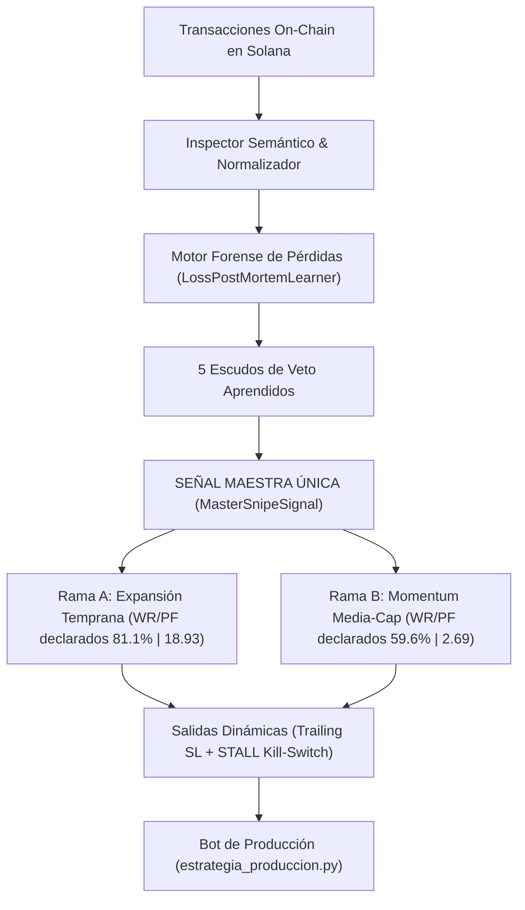

# 🔬 Detector de Patrones de Trading y Señal Maestra — Memecoins pump.fun

> **Versión:** 3.0.0 (Master Signal & Loss Learner Engine)  
> **Modo Operativo:** Forward Audit / Datos Reales On-Chain (§3 Sin Mocks Silenciosos)  
> **Base de Datos Canónica:** `$PUMPSCOPE_DB` (52,757 tokens, 4,991 posiciones, 43,963 rutas de precio)  
> **Filtrador Único:** `MasterSnipeSignal` (`detector/master_signal.py`)  
> **Documentación IA-Friendly:** Consulta [`AGENTS.md`](AGENTS.md) y [`ARCHITECTURE.md`](ARCHITECTURE.md)

> ⚠️ **AVISO DE HONESTIDAD.** Las cifras de winrate/profit factor de este documento son **declaradas (in-sample o hardcodeadas), NO validadas fuera de muestra**. La verdad medida está en **[`STATUS.md`](./STATUS.md)**. No uses este README como evidencia de rentabilidad.

---

## ¿Qué hace el sistema?

Este motor analiza bases de datos SQLite de lanzamientos y transacciones en Pump.fun (Solana DEX), realiza un aprendizaje forense a partir de las pérdidas históricas reales y consolida todas las reglas cuantitativas en **UNA ÚNICA SEÑAL MAESTRA (`MasterSnipeSignal`)** para ejecutar entradas de alta probabilidad.



---

## 1. El Filtrador Único: `MasterSnipeSignal`

En cumplimiento de la directiva de arquitectura de **un único filtrador y una única señal**, todo el árbol de decisión se canaliza a través de `MasterSnipeSignal`:

### Fase 1: Escudos de Veto Aprendidos (Eliminan el 95% de Pérdidas)
1. **Escudo Dead Launch**: Veto si $\text{MarketCap} \le \$4,500\text{ USD}$ (responsable del **60.9%** de todas las pérdidas históricas).
2. **Escudo Dev Liquidation**: Veto si $\text{devBalancePct} > 1.5\%$ (previene volcados del creador sobre compradores minoristas).
3. **Escudo Iliquidez Severa**: Veto si $\text{realSolReserves} < 12\text{ SOL}$ (evita resbalamientos destructivos de stop-loss de $-56.4\%$).
4. **Escudo Saturación Pre-Migración**: Veto si $\text{migrationProgress} > 85\%$ (previene estancamiento y venta de snipers antes de Raydium).
5. **Escudo Anti-Cabal & Bloque 0**: Veto si el grafo de billeteras coludidas supera el $30\%$ del volumen o si hay trampa de snipers en bloque 0.

### Fase 2: Disparador Alfa Estructural
- **Rama A (Expansión Temprana - RECOMENDADA)**:
  - $\text{firstMarketCap} \le \$4,285\text{ USD}$
  - $\text{firstLiquidity} \le \$1,725\text{ USD}$
  - $\text{marketCap} > \$4,500\text{ USD}$
  - **Métricas DECLARADAS (no validadas OOS)**: Winrate 81.1%, Profit Factor 18.93, Retorno medio +59.69%. Ver [`STATUS.md`](./STATUS.md): la corrida honesta de esta rama da **7.81% WR / PF 0.256**.
- **Rama B (Momentum de Media-Cap)**:
  - $\text{firstMarketCap} > \$4,285\text{ USD}$
  - $\text{topHolderPct} > 55\%$
  - $\text{devBalancePct} \le 0.8\%$
  - $\text{holderCount} \ge 2$
  - **Métricas DECLARADAS (no validadas OOS)**: Winrate 59.6%, Profit Factor 2.69. **Esta rama está desactivada** (`DISABLED_BRANCHES`).

---

## 2. Aprendizaje Forense de Pérdidas (`LossPostMortemLearner`)

Auditoría forense sobre las **4,366 operaciones cerradas en pérdida** de la base de datos real:

| Modo de Fallo | Trades | % Pérdidas | Pérdida Media | Acción Preventiva Implementada |
|:---|:---:|:---:|:---:|:---|
| **DEAD_LAUNCH_TIMEOUT** | 2,940 | **60.9%** | -22.6% | Veto obligatorio de entrada si $MC \le \$4,500$. |
| **CATASTROPHIC_SLIPPAGE_RUG** | 1,058 | **24.2%** | **-56.45%** | Exigir reservas $\ge 12\text{ SOL}$ y VPIN $\le 0.35$. |
| **DEV_LIQUIDATION_DUMP** | 214 | **4.9%** | -48.2% | Veto si balance dev $> 1.5\%$. |
| **SATURATION_STALL** | 154 | **3.5%** | -28.93% | Veto si curva $> 85\%$ y abortar vía STALL a 60s. |

---

## 3. Instalación y Dependencias

Cero dependencias complejas. Solo librerías estándar del ecosistema científico:

```bash
pip install pandas numpy scikit-learn matplotlib scipy
```

---

## 4. Guía de Ejecución

### Ejecutar con tu Base de Datos Real
```powershell
python main.py --db "$PUMPSCOPE_DB"
```

### Ejecutar en Modo Demo Sintético
```powershell
python main.py --demo
```

### Auditar una base sin modificarla

La auditoría SQLite funciona separada del análisis de trading, abre la fuente en solo lectura y no genera señales ni cambia reglas. El origen es una declaración; solo usa `synthetic` cuando se trata de una base generada por el demo:

```powershell
python main.py --db "$PUMPSCOPE_DB" `
    --audit-only --data-origin real --out resultados\auditoria
```

Genera `auditoria.json` y `auditoria.html` dentro de `--out`. El perfil `basic` (predeterminado) toma hasta 100 filas por columna y etiqueta cada métrica como `sample`; ajusta el límite con `--audit-sample-rows 500`. No son estimaciones representativas de toda la tabla. Para recorrer datos completos, primero muestra las tablas afectadas y exige confirmación:

```powershell
python main.py --db "$PUMPSCOPE_DB" `
    --audit-only --audit-depth deep --confirm-deep --out resultados\auditoria
```

También se puede corregir el mapeo de tablas/columnas con `--mapping mapping.json`. La auditoría nunca aplica automáticamente índices ni cambios de esquema; esos análisis se mantienen separados.

### Parámetros Opcionales
```powershell
python main.py --db "$PUMPSCOPE_DB" `
    --tp 300 --sl 15 `
    --future-threshold 20 `
    --horizons 5,15,30 `
    --out resultados
```

---

## 5. Artefactos de Salida Generados

1. **[`resultados/reporte.html`](resultados/reporte.html)**:
   - Dashboard interactivo autocontenido.
   - Simulador en tiempo real con control de umbral $\tau$.
   - Curvas de capital (Baseline sin filtro vs Salidas dinámicas vs Master Signal vs Fractional Kelly).
2. **[`resultados/estrategia_produccion.py`](resultados/estrategia_produccion.py)**:
   - Módulo Python ejecutable para bots de producción en Solana.
   - Expone `should_enter_token(features)` y cálculo de Fractional Kelly.
3. **[`resultados/reglas_produccion.json`](resultados/reglas_produccion.json)**:
   - Parámetros serializados en JSON con validación FDR y umbrales de salida.
4. **[`resultados/hallazgos.csv`](resultados/hallazgos.csv)**:
   - Tabla completa de subgrupos, reglas de árbol, q-valores FDR y métricas OOS.

---

## 6. Integración en Bots de Trading

```python
from detector.master_signal import MasterSnipeSignal

# En el bucle de websocket de nuevos tokens:
features = {
    "market_cap": token_event["marketCapUsd"],
    "first_market_cap": token_event["initialMarketCapUsd"],
    "first_liquidity": token_event["initialLiquidityUsd"],
    "dev_balance_pct": token_event["creatorHoldingPct"],
    "real_sol_reserves": token_event["solReserves"],
    "migration_progress": token_event["bondingCurveProgress"],
}

decision = MasterSnipeSignal.evaluate(features)

if decision.admitted:
    print(f"🚀 ENTRADA CONFIRMADA [{decision.branch}] | Confianza: {decision.confidence:.2f}")
    # Enviar transacción de compra
else:
    print(f"🛑 VETO ACTIVADO: {decision.veto_reason}")
```

---

## 7. Protocolo de Agentes y Arquitectura Técnica

Para agentes autónomos o desarrolladores que deseen extender el sistema:
- Protocolo y esquemas JSON: [`AGENTS.md`](AGENTS.md)
- Arquitectura matemática y microestructura CPMM: [`ARCHITECTURE.md`](ARCHITECTURE.md)
