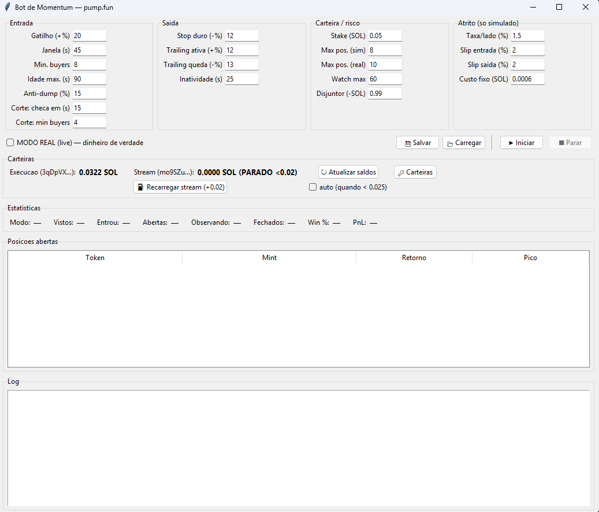

# pump.fun Momentum Bot

Momentum bot for freshly-created pump.fun tokens (Solana). It consumes the
**real-time trade stream** over WebSocket, applies entry filters, exits on
**reversal** (trailing stop from the peak), and measures the outcome with a
**realistic friction model**.

It includes an honest viability study: the bot was run with real money and the
result — with the analysis of *why* — is documented below.



> Research project. Memecoin trading is extremely high-risk; nothing here is
> financial advice.

## How it works

```
PumpPortal WebSocket ──► every token created + trades tick by tick
        │
        ▼
   WATCHLIST           filters: minimum appreciation, time window,
                       unique buyers, anti-dump, early cut
        │
        ▼
    ENTRY              fixed stake, cap on concurrent positions
        │
        ▼
    EXIT               trailing stop from peak · hard stop · inactivity
                       stop · total-loss circuit breaker
```

**No fixed take-profit**: the exit is reversal-based. The bot tracks the peak
since entry and sells when price drops X% *from that top* — letting winners run
and cutting on the turn.

## Highlights

- **Explicit friction model.** Simulated PnL deducts a per-side fee, entry/exit
  slippage, and a fixed per-trade cost. The summary shows **gross (signal only)**
  and **net (with friction)** side by side — isolating "is the signal good?" from
  "does it survive the cost?".
- **Real slippage meter** (`slippage_test.py`): compares the on-chain *bonding
  curve* price at the moment of decision with the actual fill price, and times the
  latency. It answers with a number, not a guess.
- **Encrypted vault** (`vault.py`): seed phrase and keys live in an encrypted file
  (PBKDF2-SHA256 200k + Fernet). The password is never stored — it is requested at
  runtime and the secrets exist only in memory.
- **Simulated and live modes** in the same engine, with a kill-switch and
  exposure limits.

## Setup

```bash
pip install -r requirements.txt
cp .env.example .env
python bot_gui.py
```

The GUI exposes **every parameter** (with tooltips), savable presets, wallet
balances, and a live log. It starts in simulated mode.

> PumpPortal's trade stream requires an API key with a minimum balance. Without
> it, only token-creation events arrive (no entries fire).

## Study results

Two simulation runs (~370 trades each) and one live run:

| Scenario | Result |
|---|---|
| Simulated, no friction | positive — the signal exists |
| Simulated, 2%/side friction | still positive in v2 (after tuning filters) |
| **Live** | **negative** |

**What the live run revealed:** tokens that rose +827% on the chart still closed
at a loss. The reason is latency — when the trigger fires, the order takes 1–3s to
confirm, and in that window the price has already reversed. The signal is visible;
**capturing it with retail execution is not**.

Also documented: one live session rose +24% in the first 4 minutes and gave it all
back over the next 32 — early variance masking a negative expectation, with ~90
round-trips turning the account over 7×.

**Conclusion:** the strategy does not survive retail execution friction. The code
stands as a study in real-time architecture and validation methodology.

## Stack

Python · asyncio · WebSockets · Solana (`solders`, `solana-py`) · PumpPortal ·
`cryptography` (PBKDF2/Fernet) · Tkinter

---

> `live_executor.py` is shared with
> [solana-copytrading-engine](https://github.com/charllysb/solana-copytrading-engine);
> duplicated on purpose to keep each repository runnable independently.
